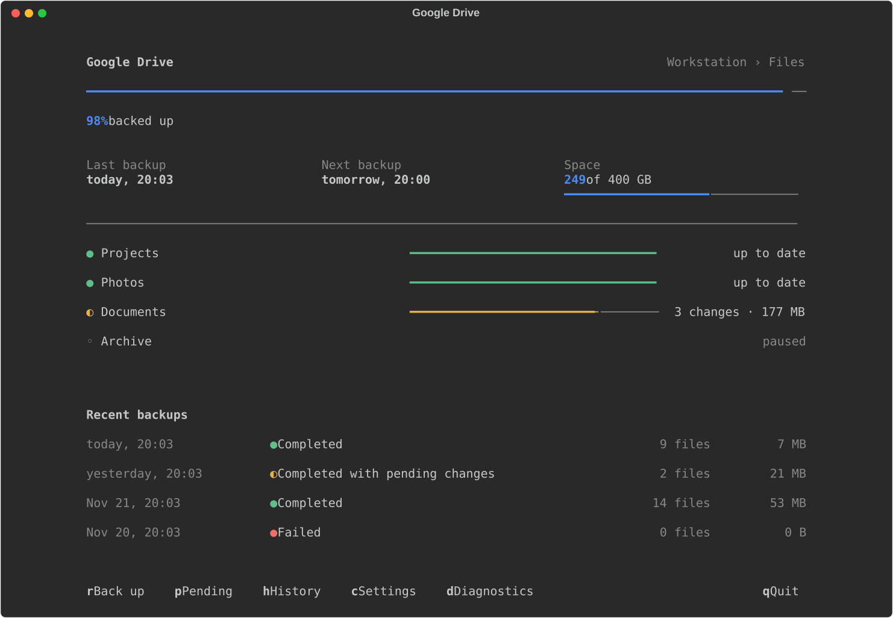
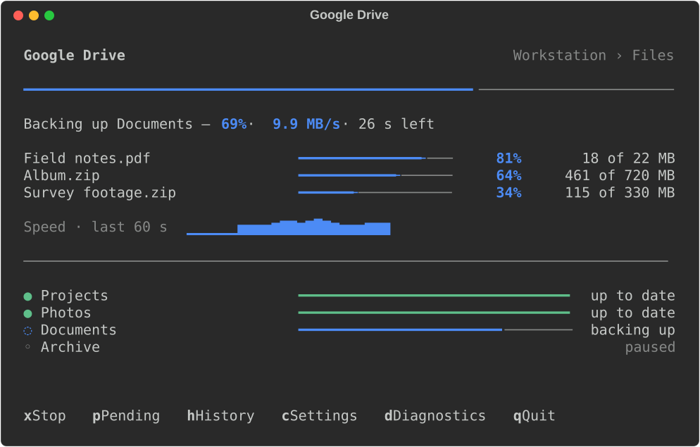

# nimbo

[Read in English](README.md)

nimbo mantiene un **espejo unidireccional** de las carpetas que elijas de tu
equipo Linux en una carpeta de tu propio Google Drive. Los archivos locales son
la fuente de verdad. Los cambios en Drive no se sincronizan de vuelta y el
espejo no conserva versiones independientes del respaldo. Un diario permite
reanudar respaldos interrumpidos y un temporizador de usuario de systemd ejecuta
el respaldo cada día.





## Instalación y configuración

Usa Linux con Python 3.11 o posterior y un llavero compatible con Secret
Service que esté desbloqueado (por ejemplo, GNOME Keyring o una configuración
compatible de KWallet). Para programar respaldos, necesitas una sesión con el
gestor de usuario de systemd activo.

Instala desde este repositorio con pipx o uv. El paquete `nimbo` de PyPI es otro
proyecto sin relación, así que no lo instales por nombre.

```sh
pipx install git+https://github.com/davidgil9302/nimbo.git
# O bien
uv tool install git+https://github.com/davidgil9302/nimbo.git
```

Sigue la [guía del cliente OAuth de escritorio](docs/oauth-client.es.md) para
crear tus propias credenciales de Google. Ejecuta el asistente y autoriza la
aplicación en tu navegador.

```sh
backup instalar
```

El asistente pide la raíz local (por ejemplo, `/media/alice/DATA`), las
subcarpetas que quieres reflejar (como `Projects` y `Photos`), el enlace o ID de
una carpeta existente de Drive y una hora diaria (20:00, hora local, de forma
predeterminada). Usa una carpeta de Drive dedicada al espejo para evitar que
se envíen a la papelera archivos ajenos al respaldo. El asistente escribe un
testigo en la raíz local y habilita el temporizador de usuario.

**Ordenadores / Mi portátil (Computers / My Laptop).** La API de Google Drive
no permite crear carpetas de nivel superior dentro de un equipo de
**Ordenadores**. Si quieres usar ese destino, crea la carpeta una vez desde
Google Drive para ordenadores en Windows o macOS y copia su enlace en el
asistente. También puedes crear y usar una carpeta en **Mi unidad**.

## Uso diario

Ejecuta `backup` (o su alias `nimbo`) en una terminal para abrir el panel.
Pulsa `p` para ver los cambios pendientes, `r` para iniciar el respaldo, `h`
para consultar el historial o `q` para salir. Los nombres en español y sus
alias en inglés funcionan con ambos idiomas. Elige el idioma con
`backup --idioma es` o `backup --lang en`.

| Comando | Acción |
| --- | --- |
| `backup pendientes` | Consulta las subidas, los movimientos y los borrados previstos. |
| `backup ahora` | Inicia un respaldo. |
| `backup ahora --aqui` | Ejecuta un respaldo y muestra el progreso en la terminal actual. |
| `backup estado` | Consulta el estado del respaldo y del temporizador. |
| `backup historial` | Muestra las ejecuciones recientes y sus números. |
| `backup verificar` | Compara el espejo de Drive con los archivos locales. |
| `backup detener` | Detiene un respaldo que se ejecuta como servicio de systemd. |
| `backup diagnostico` | Comprueba la configuración y muestra cómo resolver los fallos. |

Consulta todos los comandos con `backup --help`.

## Seguridad del respaldo

- **Testigo del origen.** nimbo comprueba el UUID guardado en `.nimbo-root` y,
  si `source.require_mount` está activado, que el origen esté montado. Si
  falta una carpeta activa, está vacía o no se puede leer, se detiene el respaldo.
- **Frenos de borrado.** Los planes de borrado masivo se detienen para
  revisión. Con los valores predeterminados, esto ocurre si se superan los
  500 archivos en total o el 10 % de una carpeta cuando se borrarían al menos
  20 archivos en ella. Revisa la lista con `backup ahora --confirmar` o en el
  panel. La aprobación corresponde al plan revisado.
- **Papelera y recuperación.** Los borrados envían los elementos a la papelera
  de Drive. Mientras estén disponibles allí, `backup deshacer` deshace la
  última ejecución con borrados registrados. Indica un número, por ejemplo
  `backup deshacer 12`, para elegir otra ejecución. También recupera las rutas
  locales que falten y omite las que ya existan.
- **Control de pertenencia.** El motor verifica que las escrituras queden
  dentro de la carpeta de Drive configurada. Los archivos nativos de Google,
  los accesos directos y las rutas excluidas están protegidos contra los
  borrados del espejo.

## Límites y privacidad

Con el ritmo de escritura predeterminado se crean aproximadamente **tres
archivos por segundo**. El primer respaldo puede tardar mucho si contiene
muchos archivos pequeños. Google Drive también limita las subidas a
**750 GB diarios**. Si se alcanza ese límite, nimbo pone el respaldo en pausa y
deja los archivos restantes pendientes para otra ejecución.

Los datos del respaldo solo viajan entre tu equipo y Google. El proyecto
nimbo no recibe tus archivos, sus nombres ni los datos de tu cuenta. nimbo usa
el permiso OAuth `drive` para reflejar el contenido en una carpeta existente
y trabajar con archivos que la aplicación no creó. El control de pertenencia
limita las escrituras del espejo a la carpeta que elijas. El token de
actualización se guarda en tu llavero local y el diario del respaldo se queda
en tu equipo. Consulta la [política de privacidad](site/privacy.html#es).

## Desinstalación

Ejecuta `backup desinstalar` antes de quitar el paquete de Python. El comando
detiene el servicio y elimina sus unidades y el temporizador. Para borrar
también la configuración, el historial, los registros y el token local, usa
`backup desinstalar --borrar-datos --revocar` y revisa la confirmación. La
revocación también retira el acceso de la credencial en Google. Estos comandos
dejan intactos los archivos de origen y el espejo en Drive.

```sh
pipx uninstall nimbo
# O bien, si lo instalaste con uv
uv tool uninstall nimbo
```

## Documentación en inglés

- [Configuración](docs/configuration.md)
- [Solución de problemas](docs/troubleshooting.md)
- [Arquitectura](docs/architecture.md)
- [Pruebas](docs/testing.md)
- [Cómo contribuir](CONTRIBUTING.md)
- [Seguridad](SECURITY.md)
- [Registro de cambios](CHANGELOG.md)
- [Licencia MIT](LICENSE)
