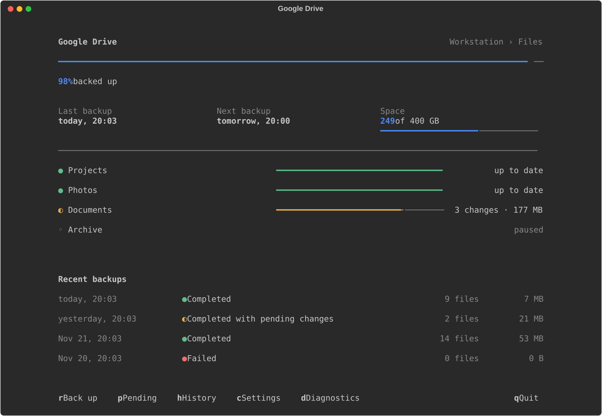
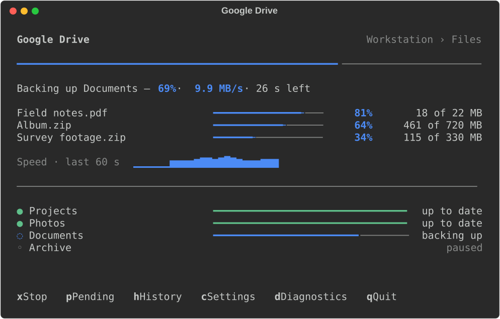

# nimbo

[Leer en español](README.es.md)

nimbo keeps a **one-way mirror** of selected folders on your Linux computer in a
folder in your own Google Drive. Your local files are the source of truth. Edits
in Drive do not sync back, and the mirror does not keep independent backup
versions. A journal helps interrupted backups resume, and a systemd user timer
runs the backup daily.





## Install and set up

Use Linux with Python 3.11 or newer and an unlocked Secret Service keyring
(such as GNOME Keyring or a compatible KWallet setup). For scheduled backups, use
a session with a running systemd user manager.

Install from this repository with either pipx or uv. The `nimbo` package on
PyPI is an unrelated project, so do not install it by name.

```sh
pipx install git+https://github.com/davidgil9302/nimbo.git
# Or
uv tool install git+https://github.com/davidgil9302/nimbo.git
```

Follow the [OAuth desktop client guide](docs/oauth-client.md) to create your own
Google credentials. Run the setup wizard and authorize the app in your browser.

```sh
backup instalar
```

The wizard asks for a source root (for example, `/media/alice/DATA`), the
subfolders to mirror (such as `Projects` and `Photos`), an existing Drive folder
link or ID, and a daily time (20:00 local time by default). Use a dedicated Drive
folder so the mirror does not move unrelated files to the trash. Setup writes a
marker to the source root and enables the user timer.

**Computers / My Laptop.** The Google Drive API cannot create top-level folders
inside a device listed under **Computers**. To use that location, create the
target folder once via Google Drive for desktop on Windows or macOS, then give
the wizard its link. You can also create and use a folder in **My Drive**.

## Daily use

Run `backup` (or its alias `nimbo`) in a terminal to open the dashboard. Press
`p` to preview, `r` to start a backup, `h` for history, or `q` to quit.
Both languages accept Spanish command names and English aliases. Use
`backup --lang en` or `backup --idioma es` to choose the language.

| Command | Action |
| --- | --- |
| `backup pendientes` | Preview uploads, moves, and trash operations. |
| `backup ahora` | Start a backup. |
| `backup ahora --aqui` | Run a backup in the current terminal and show progress. |
| `backup estado` | Check backup and timer status. |
| `backup historial` | See recent runs and their numbers. |
| `backup verificar` | Audit the Drive mirror against local files. |
| `backup detener` | Stop a backup running as a systemd service. |
| `backup diagnostico` | Check the setup and see hints for failures. |

Use `backup --help` for the full command list.

## Safety

- **Source marker.** nimbo checks the UUID in `.nimbo-root` and, when
  `source.require_mount` is enabled, that the source is mounted. A missing,
  unreadable, or empty active source folder stops the backup.
- **Deletion brakes.** Large deletion plans wait for review. By default, this
  happens above 500 files overall or above 10% in one folder when at least 20
  files would be deleted there. Review the list with `backup ahora --confirmar`
  or in the dashboard. Approval applies to the reviewed plan.
- **Drive trash and undo.** Deletes move items to the Drive trash. While those
  items are available, `backup deshacer` undoes the latest run with recorded
  deletions. Pass a run number, for example `backup deshacer 12`, to select a
  specific run. Undo also restores missing local paths and skips existing ones.
- **Membership guard.** The engine checks that writes stay inside the
  configured Drive folder. Google-native files, shortcuts, and excluded paths
  are protected from mirror deletes.

## Limits and privacy

At the default write rate, expect about **three file creations per second**.
A first backup with many small files can take a long time. Google Drive also
limits uploads to **750 GB per day**. If that limit is reached, nimbo pauses
and leaves the remaining files pending for a later run.

Backup data travels only between your computer and Google. The nimbo project
does not receive your files, file names, or account data. nimbo uses the Google
`drive` OAuth scope so it can mirror into a pre-existing target folder and work
with files it did not create. The membership guard limits the effect of mirror
writes to the folder you choose. The refresh token stays in your local keyring,
and the backup journal stays on your computer. See the [privacy policy](site/privacy.html).

## Uninstall

Run `backup desinstalar` before removing the Python package. That stops the
service and removes the timer and service units. To also remove local settings,
history, logs, and the saved token, run
`backup desinstalar --borrar-datos --revocar` and review the prompt. Revocation
also removes the credential's access at Google. These commands leave the
source files and the Drive mirror in place.

```sh
pipx uninstall nimbo
# Or, if installed with uv
uv tool uninstall nimbo
```

## Documentation

- [Configuration](docs/configuration.md)
- [Troubleshooting](docs/troubleshooting.md)
- [Architecture](docs/architecture.md)
- [Testing](docs/testing.md)
- [Contributing](CONTRIBUTING.md)
- [Security](SECURITY.md)
- [Changelog](CHANGELOG.md)
- [MIT license](LICENSE)
